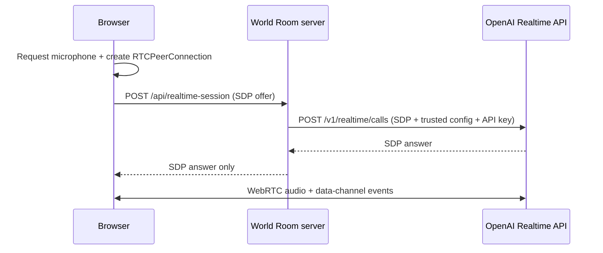

# World Room

A voice-first worldbuilding studio powered by the OpenAI Realtime API. Speak naturally with a live companion that helps invent places, characters, conflicts, secrets, and scene hooks.

The app uses a persistent WebRTC session with audio input and output—not a request/response text loop. Realtime transcript events are rendered as local field notes while WebRTC carries the model’s audio stream.

## Quick start

Requirements: Node.js 20+ and an OpenAI API key with access to the Realtime API.

```bash
npm install
cp .env.example .env
```

Set your key in `.env`:

```bash
OPENAI_API_KEY=sk-your-key-here
PORT=3001
```

Then run:

```bash
npm run dev
```

Open [http://localhost:5173](http://localhost:5173). The Vite development server proxies `/api` to the local session server on port 3001. Allow microphone access when prompted; using headphones gives the cleanest interruption behavior.

For a production-style local run:

```bash
npm run build
npm start
```

Open [http://localhost:3001](http://localhost:3001).

Never place `OPENAI_API_KEY` in client code or in a `VITE_*` variable. `.env` files are ignored by Git.

## Architecture and trust boundary



Browser responsibilities:

- Ask for and release microphone permission.
- Create the WebRTC peer connection and attach the microphone track.
- Play the remote model audio stream.
- Receive Realtime lifecycle/transcript events over the data channel.
- Render mic, model-speaking, reconnect, mute, and transcript states.
- Keep the transcript in React memory only; the app does not persist it.

Server responsibilities:

- Read `OPENAI_API_KEY` from the server environment.
- Accept only bounded `application/sdp` payloads.
- Attach the trusted model, voice, VAD, prompt, and output limits.
- Exchange the browser’s SDP at `POST /v1/realtime/calls`.
- Rate-limit session creation and return generic errors without leaking upstream details.
- Serve the built frontend in production.

The server uses the unified WebRTC interface described by the [official WebRTC guide](https://developers.openai.com/api/docs/guides/realtime-webrtc). OpenAI recommends WebRTC over WebSockets for browser clients because it provides more consistent performance on uncertain networks. The current [Realtime overview](https://developers.openai.com/api/docs/guides/realtime) identifies `gpt-realtime-2.1` for low-latency voice agents; the broader [model catalog](https://developers.openai.com/api/docs/models) is the source of truth when updating models.

## Developer notes

### Latency

- Audio travels directly over WebRTC after the SDP handshake; the app server is only in the session-initialization path.
- `semantic_vad` avoids cutting off hesitant or unfinished utterances. For a snappier but more silence-sensitive feel, switch to `server_vad` and tune `silence_duration_ms` using the [VAD guide](https://developers.openai.com/api/docs/guides/realtime-vad).
- The companion prompt asks for short spoken turns and caps each response at 500 output tokens. Shorter turns usually feel more conversational and reduce cost.
- Input and output meters use `AnalyserNode`; they never record or upload separate audio copies.
- Headphones reduce acoustic echo and improve natural interruption (“barge-in”).

### Session lifecycle

- A session starts only after a user gesture so microphone and audio autoplay permissions can succeed.
- The UI treats `session.created`, speech start/stop, transcript delta, response completion, peer disconnection, and explicit end as distinct states.
- Realtime sessions are stateful and currently have a 60-minute maximum. For a longer experience, create a new session and optionally carry forward a compact, user-approved world summary. See [Realtime conversations](https://developers.openai.com/api/docs/guides/realtime-conversations).
- The `marin` voice is configured server-side and cannot be changed after the first audio response in a session.

### Permissions and privacy

- `getUserMedia` requires a secure context. `localhost` is allowed for development; deploy behind HTTPS.
- Permission denial and missing-device errors are translated into actionable UI copy.
- Microphone tracks are stopped on disconnect and component teardown.
- The standard OpenAI API key never reaches browser JavaScript, network storage, logs, or the transcript.
- Transcript/model text is treated as untrusted display data and rendered through React escaping; it is never inserted as HTML.
- This demo has no user authentication. Add authentication and per-user authorization before exposing session creation publicly.

### Error recovery

- SDP input is type-checked and size-limited; session attempts are rate-limited.
- OpenAI/network failures produce a generic retry message. The in-memory transcript remains visible.
- A failed/disconnected peer moves the UI to **Reopen the room**, which creates a fresh peer connection and new server-side session.
- Reconnect does not silently replay prior audio or transcript. If continuity is required, explicitly summarize and re-seed the next session.
- The server’s OpenAI request has a 15-second timeout; the browser can retry safely after failure.

## Validation checklist

Audio and permissions:

- [ ] First click shows the browser microphone permission prompt.
- [ ] Allowing permission opens the session and plays the companion’s greeting.
- [ ] Denying permission returns the UI to idle with actionable instructions.
- [ ] No-microphone environments show the missing-device message.
- [ ] Mute disables the local audio track and unmute restores it.
- [ ] Ending a session stops the browser’s microphone indicator.
- [ ] Headphone and speaker tests do not produce an echo loop.

Connection and recovery:

- [ ] With `OPENAI_API_KEY` absent, the server returns `503` and the UI offers retry-safe feedback.
- [ ] Temporarily dropping the network exposes **Reopen the room** without erasing field notes.
- [ ] Reopening creates one new connection and does not leave the old microphone track active.
- [ ] Repeated session creation beyond the limit returns `429` without internal details.
- [ ] Production responses include CSP, frame, MIME-sniffing, and referrer security headers.

Conversation quality:

- [ ] The companion builds on the user’s premise rather than replacing it.
- [ ] Spoken turns are usually one vivid contribution plus one useful question.
- [ ] The companion remembers at least three established world facts within a session.
- [ ] Interrupting the companion stops the current response and gives the user the floor.
- [ ] Assistant audio transcript appears incrementally; completed user turns appear as field notes.
- [ ] Each seed produces a materially different opening.

Engineering checks:

```bash
npm test
npm run build
npm audit --audit-level=high
```

The automated suite covers transcript event reduction, connection-error messaging, model/session configuration, the SDP trust boundary, upstream failure handling, and health reporting.

## Project map

- `src/App.jsx` — voice workspace and session states
- `src/realtime/client.js` — browser WebRTC/media lifecycle
- `src/realtime/events.js` — Realtime event-to-transcript reducer
- `server/app.js` — protected SDP handoff and production server
- `server/session-config.js` — trusted model, voice, VAD, and companion prompt
- `server/*.test.js`, `src/realtime/*.test.js` — unit and integration coverage
